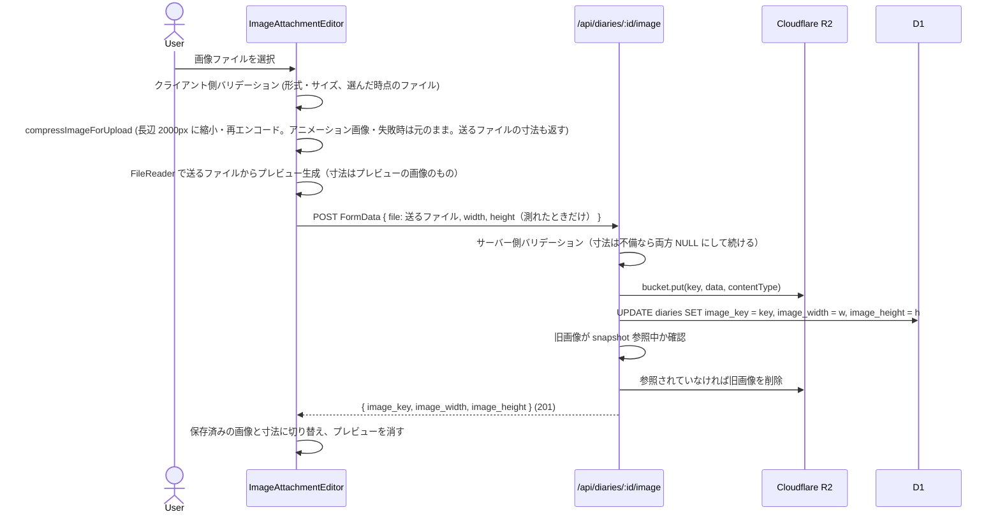
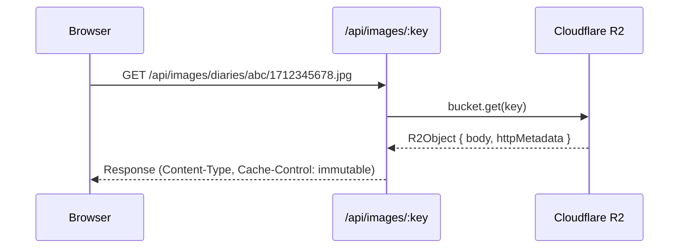
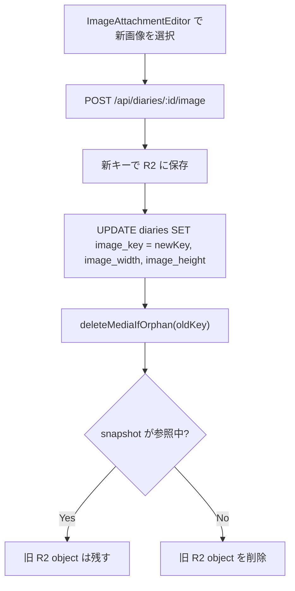
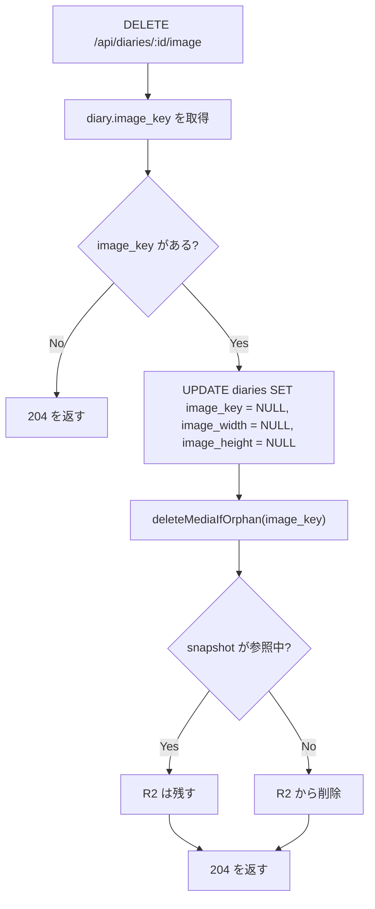
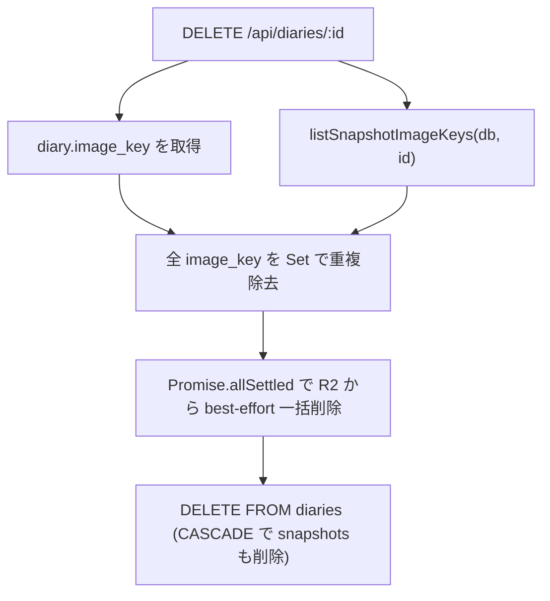

# Image Upload & Storage

## Overview

Cloudflare R2 を使った画像のアップロード・配信・削除。日記1件につき画像1枚。テキストの回り込みレイアウトと連携する。

## R2 ストレージ構成

```
R2 Bucket: 400-diary-images
└── diaries/
    └── {diaryId}/
        └── {timestamp}-{id}.{ext}    ← 例: diaries/abc123/1712345678-a1b2c3d4.jpg
```

- キー生成: `diaries/${diaryId}/${Date.now()}-${nanoid(8)}.${ext}`
- タイムスタンプと短いランダム ID でユニーク性を保証（同じ日記への再アップロードで上書きしない）

## バリデーション

| チェック | 制限 | エラーメッセージ |
|---------|------|----------------|
| ファイル形式 | JPEG, PNG, WebP, GIF | 「JPEG, PNG, WebP, GIF のみアップロードできます」 |
| ファイルサイズ | 10MB以下 | 「画像は10MB以内にしてください」 |

クライアント側とサーバー側の両方でバリデーション（多層防御）。

クライアント側の確認は、選んだ時点のファイル（圧縮の前）に対して行う。通らなければ上の文言で断り、圧縮もアップロードもしない。サーバー側は圧縮の有無に関係なく、送られてきたファイルの申告 MIME と先頭バイト（シグネチャ）の一致を確かめる。

## ブラウザでの圧縮

スマートフォンの写真は数 MB あり、そのまま保存すると日記ページの表示が遅くなる。日記の中の表示幅は最大 400px ほど、タップ時の拡大表示も画面の大きさまでなので、アップロードの前にブラウザで縮小・再エンコードして軽くする。サーバー（Workers）には画像を加工する標準の仕組みがないため、ブラウザで行う。処理は `app/lib/image-compress.ts` の `compressImageForUpload`。

| 項目 | 内容 |
|------|------|
| 大きさ | 長辺が 2000px（`IMAGE_COMPRESS_MAX_EDGE`）を超えるときだけ、縦横比を保って長辺 2000px に縮める。拡大はしない |
| 形式 | JPEG は JPEG のまま。PNG と WebP は透過を残せる WebP にする（ブラウザが WebP で書き出せなければ PNG） |
| 品質 | 0.85（`IMAGE_COMPRESS_QUALITY`） |
| 向き | EXIF の Orientation を反映して描く（`createImageBitmap` の `imageOrientation: 'from-image'`）。書き出した画像には EXIF が付かない（位置情報なども消える） |
| 送るファイル | 書き出した形式に合った MIME と拡張子の File にする（サーバーが申告 MIME と中身の一致を確かめるため） |
| プレビュー | 実際に送るファイル（圧縮後、または元のまま）から data URL で作る |

### 圧縮しないもの

次のものは再エンコードせず、元のファイルをそのまま送る。再エンコードすると最初の 1 コマだけになり、動かなくなるため。

- GIF（判定せず、常に圧縮しない）
- アニメーション WebP（RIFF の最初のチャンクが `VP8X` で、アニメーションのフラグ（0x02）が立っているもの）
- APNG（PNG のチャンクを先頭からたどり、最初の `IDAT` より前に `acTL` があるもの）
- アニメーションかどうかを判定できない PNG / WebP（チャンクの長さが壊れている、途中で切れている、`IDAT` にも `acTL` にも着かずに終わる、など）。アニメーション画像はブラウザで静止画として問題なく読み込めてしまい、圧縮の失敗では守れないため、判定できないものも元のまま送る

### 元のまま送る場合

| 状況 | 送るファイル |
|------|-------------|
| 縮小した（長辺が 2000px を超えていた） | 圧縮後が 10MB 以下なら、元より大きくても圧縮後 |
| 縮小していない（長辺が 2000px 以下） | 圧縮後のほうが小さいときだけ圧縮後。元以上なら元 |
| 圧縮後が 10MB（`MAX_IMAGE_SIZE`）を超える | 縮小したかに関係なく元。元は選んだ時点の確認で 10MB 以下なので、圧縮したせいで断られない |
| 読み込めない・書き出せないなど、圧縮の途中で失敗した（`createImageBitmap` や `imageOrientation: 'from-image'` に対応していないブラウザを含む） | 元。今までどおりアップロードできることを優先する |

## 画像の寸法

画像を表示するとき、寸法が分からないと文章は画像なしで組まれ、読み込みが終わった時点で画像を避けて組み直される。読んでいる最中に文章が動くので、画像の幅と高さを DB（`diaries` と `diary_snapshots` の `image_width` / `image_height`）に持ち、表示の最初から画像の場所を空けて組む。

### 定義

- ブラウザが画像を表示するときの幅と高さ（px）。EXIF の向きを反映した値で、`` の `naturalWidth` / `naturalHeight` と一致する
- 幅と高さは両方そろっているか、両方 NULL のどちらか。片方だけの行は作らない
- 値は 1 以上 100000（`IMAGE_DIMENSION_MAX`）以下の整数

### どこから来るか

寸法はブラウザが測って、アップロードと一緒に送る。圧縮のために画像をデコードした時点で分かっているので、サーバーに画像を解析する処理を足さずに済む。サーバーは画像の中身から寸法を読まず、ログイン済みの本人のブラウザが測った値として扱う。

`compressImageForUpload` は送るファイルと一緒に、そのファイルの寸法を返す。

| 送るファイル | 寸法 |
|-------------|------|
| 圧縮後 | 縮めた後の幅と高さ |
| 元のまま（軽くならなかった、10MB を超えた、書き出しに失敗したなど。デコードはできた） | 元の画像の、向きを反映した幅と高さ |
| 圧縮しない画像（GIF、アニメーション WebP、APNG、判定できなかったもの） | 寸法を知るためだけにデコードを試み、取れたらその値、取れなければ null |
| デコードに失敗した | null |

寸法の取得のために、どのファイルを送るかの判断は変えない。寸法が取れたときだけ、FormData に `width` と `height` を組で足す。

`POST /api/diaries/:id/image` は、`width` と `height` が両方とも「1 以上 100000 以下の整数を表す 10 進の文字列」のときだけ採用する。どちらかが無い、または形式が合わないときは両方 NULL で保存し、アップロード自体は成功させる。寸法が無くても画像は表示できる（読み込み後に組む）ので、寸法の不備で画像を断らない。画像キーと寸法は同じ 1 回の UPDATE で保存し、応答の JSON にも `image_width` / `image_height` を返す。

- 画像を削除すると（`DELETE /api/diaries/:id/image`）、画像キーと一緒に寸法も NULL になる
- 公開すると（`publishDiary`）、ほかの画像の項目と同じように寸法もスナップショットへ写す
- 日記を保存する API（`PUT /api/diaries/:id`）からは寸法を変えられない
- 寸法の列を足す前に保存された画像には寸法が無い。一括パッチ（`scripts/backfill-images.mjs`。手順は `docs/deploy/README.md` の「作者の更新を取り込む」）で記録できる

### 表示での使い方

`FlowText` は、配置の計算に使う寸法を次の順で決める（`app/lib/image-dimensions.ts` の `chooseLayoutImageSize`）。

1. いま表示している画像の読み込みが終わっていれば、その実寸
2. まだなら、props（`imageDimensions`）で渡された寸法
3. どちらも無ければ、今までどおり画像なしで組み、読み込み後に組み直す

読み込み後の実寸が渡された寸法と違えば、実寸で組み直す。保存された寸法が間違っていても、最終的な表示は今までと同じになる。実寸はどの画像（src）を測ったかと一緒に持ち、画像を差し替えたあとに前の画像の実寸を使わない。

渡す寸法は「いま表示している画像」のものにする。

- 公開ページは、スナップショットの寸法を渡す
- 編集画面は、日記の寸法を初期値にする。画像を選び直した直後はプレビュー（送るファイル）を表示するので、その間はプレビューの寸法を渡す。アップロードが終わればサーバーが保存した寸法、失敗してプレビューを取り消せば保存済みの画像の寸法に戻る（`resolveEditorImage`）。寸法が測れなかったプレビューでは、前の画像の寸法で代用せず寸法なしにする

値の選び方は props と state から render 中に導出し、Effect で state を同期しない。

## 前提条件

画像アップロードは `POST /api/diaries/:id/image` で日記IDを必要とするため、**日記を一度保存してからでないと画像を追加できない**。新規作成時はまず本文を保存し、その後に画像をアップロードする流れになる。

## アップロードフロー



DB 更新は R2 アップロード後に行う。旧画像の R2 削除は `deleteMediaIfOrphan` 経由の best-effort で、削除に失敗してもレスポンスは成功のまま返す。

### 処理中の表示

大きな画像では圧縮とアップロードに時間がかかるため、その間は処理中であることを示す。

- いつから: クライアント側の確認（未保存の日記、形式、10MB）を通った時点。確認で断った場合は処理中にしない
- いつまで: 圧縮とアップロードが終わるまで。成功・失敗・例外のどれでも解除する（`finally`）
- 表示: 画像を選ぶボタンの文言を「処理中…」にし、`aria-busy="true"` を付ける
- 押せなくなるもの: 画像の選び直し（file input を `disabled`）と「画像を削除」ボタン。どちらも不透明度を下げ、カーソルを通常に戻して押せないことを見た目でも示す

## 画像配信フロー



### キャッシュ戦略

```
Cache-Control: public, max-age=31536000, immutable
```

- 1年間キャッシュ
- `immutable`: 画像は変更されない（タイムスタンプベースのキーのため安全）
- 画像の差し替え時は新しいキーが生成される

## 削除フロー

### 画像の差し替え



### 画像の削除



DB 更新を先に行い、DB 更新に失敗した場合は R2 を削除しない。公開スナップショットが参照している画像も削除しない。

### 日記の削除時



- 下書きの画像キーとスナップショットの画像キーを両方収集
- R2 のオーファン画像を防ぐ

## 画像レイアウト

画像は `image_x` / `image_y`（REAL, nullable）で任意の座標に配置できる。プレビュー画面ではドラッグで自由に移動可能。

- `image_x` / `image_y` が設定されている場合: その座標に画像を配置
- `image_x` / `image_y` が null の場合: `image_layout`（`left` / `right`）からデフォルト位置を導出

表示サイズは `image_scale`（REAL, nullable）で調整できる。エディタのスライダー、またはプレビュー上のピンチ操作（指2本）で 0.5〜1.5 倍（null は 1.0 扱い）を指定する。自然サイズ（画像ファイル固有のピクセル寸法。`naturalWidth`/`naturalHeight`）を基準枠（コンテナ幅 30% / 高さ 256px）に収めたサイズが倍率 1.0 の基準で、そこに倍率を乗算した幅・高さを img に明示指定するため、基準枠より小さい画像でも倍率どおりに拡縮される。下限はタップ・視認性、上限はテキストの回り込み先の確保が理由。

回転は `image_rotation`（REAL, nullable, 度）で -15〜15° の範囲で傾けられる（null は 0 扱い）。エディタのスライダー、またはピンチ中の2本指の回転で指定する。回り込み・ドラッグ範囲・タップ領域は回転後の画像を包む外接矩形を基準にしており、±15° 程度の傾きであれば矩形近似による角の空白は目立たない（これが角度を絞っている理由）。最大倍率と回転の組み合わせで外接矩形がコンテナからはみ出す場合は、保存値は変えずに表示上だけ収まるサイズへ追加補正する。

```
自由配置（画像が中央付近）:
┌──────────────────────┐
│あいう   ┌──────┐     │
│えおか   │      │     │
│        │ 写真 │     │
│きくけ   │      │     │
│こさし   └──────┘     │
│すせそたちつてとな     │
└──────────────────────┘
  ↕ 画像と重なる列は上下に分割
```

FlowText コンポーネントが `computeSlots` で画像を障害物として扱い、重なる列を上下に分割してテキストの回り込みを実現する。

## storage.ts の関数

| 関数 | 用途 |
|------|------|
| `validateImage(size, type)` | 形式・サイズチェック |
| `generateImageKey(diaryId, mime)` | R2 キー生成 |
| `uploadImage(bucket, key, data, contentType)` | R2 へアップロード |
| `getImage(bucket, key)` | R2 から取得 (body + contentType) |
| `deleteImage(bucket, key)` | R2 から削除 |

## セキュリティ上の考慮

### 未公開日記の画像アクセス

`GET /api/images/diaries/...` エンドポイントは**認可チェックを行いません**。そのため、URL を知っていれば誰でも画像を取得できます。未公開日記の画像でも同様です。

このポリシーが受容可能なリスクと判断している理由：

1. **キーの推測困難性**: 画像キーは `diaries/{diaryId}/{timestamp}-{nanoid(8)}.{ext}` 形式で生成されます。`nanoid(8)` は約 281兆通りの組み合わせを持ち、タイムスタンプとの組み合わせで実質的に推測が不可能です
2. **単一ユーザー前提**: 本アプリケーションは単一ユーザーの個人日記を想定した設計です。アップロードできるのはオーナーのみであり、URL を知られる機会は限定的です
3. **露出するのは画像のみ**: 仮に URL が漏れても露出するのは画像単体で、日記本文は露出しません。本文の公開制御は snapshot の仕組み（未認証時は公開 snapshot のみ返す）で担保されています

### 将来の運用における認可チェック追加の検討

以下のシナリオでは、認可チェック機構の追加が**必要になります**：

- マルチユーザー化: 複数ユーザーが同じシステムを使用する場合
- 機密性の高い画像: 非公開日記に企業資料・個人情報など高機密の画像が含まれる可能性がある場合

### エンドポイント露出制御

`diaries/` プレフィックス以外の R2 オブジェクト（`fonts/` や `og/` など内部用途）は、このエンドポイント経由では配信されません（`app/routes/api/images/[...key].ts` で prefix チェック）。これにより、意図しない内部オブジェクトの外部露出を防いでいます。

## 関連ファイル

| ファイル | 役割 |
|---------|------|
| `app/lib/storage.ts` | R2 操作・バリデーション |
| `app/lib/media-cleanup.ts` | snapshot 参照を考慮した R2 孤児削除 |
| `app/routes/api/diaries/[id]/image.ts` | アップロード・削除 API |
| `app/routes/api/images/[...key].ts` | 画像配信エンドポイント |
| `app/routes/api/diaries/[id].ts` | 日記削除時の画像 R2 クリーンアップ |
| `app/lib/image-compress.ts` | アップロード前のブラウザでの圧縮（縮小・再エンコード、アニメーション判定、送るファイルの選択、送るファイルの寸法、アップロードの FormData） |
| `app/lib/image-dimensions.ts` | 表示に使う寸法の選び方（読み込み後の実寸と渡された寸法、編集画面のプレビューと保存済みの画像） |
| `app/islands/image-attachment-editor.tsx` | アップロード・削除 UI、圧縮の呼び出し、送るファイルからのローカル preview 生成 |
| `app/islands/vertical-editor.tsx` | 編集画面での画像 state（保存済みの画像・プレビューと、それぞれの寸法）/ 座標 state の保持と子コンポーネントへの受け渡し |
| `app/islands/flow-text.tsx` | 画像回り込みレイアウト（保存済みの寸法で読み込み前から組む） |
| `scripts/backfill-images.mjs` | 寸法の無い既存の画像に寸法を記録し、同じ基準で再圧縮する一括パッチ（判断は `scripts/lib/image-backfill.mjs`） |
| `app/lib/db.ts` | `listSnapshotImageKeys` (削除時の R2 クリーンアップ) |
