# 本番デプロイ手順

このリポジトリを fork して、自分の Cloudflare 環境にデプロイする手順です。

## やること

1. リポジトリを fork し、`wrangler.toml.example` をコピーして `wrangler.toml` を作り、自分の環境の値を入れる（[wrangler.toml で書き換える値](#wranglertoml-で書き換える値)）
2. Cloudflare に D1 データベースと R2 バケットを作成する
3. OGP画像用フォントを R2 にアップロードする
4. Cloudflare Pages にデプロイする
5. Cloudflare Access で認証を設定する
6. （任意）日記の読み上げに使うキーを登録する
7. 再デプロイして動作確認する

## wrangler.toml で書き換える値

`wrangler.toml` は自分の環境の値を入れるファイルで、git の管理に入れていません（`.gitignore` 済み）。fork したら、ひな形の `wrangler.toml.example` をコピーして作ります。

```
cp wrangler.toml.example wrangler.toml
```

ひな形の `<...>` の値は、決まった時点で自分の値に書き換えます。`<...>` が残っていると、`pnpm run deploy` と `pnpm run db:migrate:remote` は始める前に、その行を示して止まります。任意の値は、使うものだけコメントを外して書き換えます。

`wrangler.toml` は git に入らないので、別の PC で作業するときは同じ内容のファイルを用意してください。作者の更新を取り込んでも、自分の `wrangler.toml` とはぶつかりません。

| 値 | 必須 | いつ決まるか | 設定する内容 |
|---|---|---|---|
| `name` | Yes | 最初に決める | Cloudflare Pages のプロジェクト名。URL（`https://<name>.pages.dev`）になる。Cloudflare Pages 全体でユニークである必要がある。ひな形の `400-diary` は wrangler が形式を確かめるため `<...>` にしていないので、自分の名前に変える |
| `database_id` | Yes | [D1 データベースの作成](#d1データベースの作成)のあと | 作成した D1 の ID |
| `CF_ACCESS_TEAM_DOMAIN` | Yes | [Cloudflare Access の設定](#cloudflare-access-の設定)の途中 | `<チーム名>.cloudflareaccess.com` |
| `CF_ACCESS_AUD` | Yes | [Cloudflare Access の設定](#cloudflare-access-の設定)の最後 | Access アプリケーションの AUD タグ |
| `APP_NAME` | No | いつでも | アプリ名。トップページの見出し、ページのタイトル、RSS、OGP 画像に出る。書かなければ「400字日記」 |
| `APP_DESCRIPTION` | No | いつでも | 説明文。トップページの説明、RSS、トップの OGP 画像に出る。書かなければ「400文字で綴る日記」 |
| `X_URL` | No | いつでも | トップのフッターに出す X のリンク。書かなければリンクを出さない |
| `GITHUB_URL` | No | いつでも | トップのフッターに出す GitHub のリンク。書かなければリンクを出さない |
| `CF_WEB_ANALYTICS_TOKEN` | No | いつでも | Cloudflare Web Analytics のトークン。書かなければ解析のスクリプトを出さない |

- D1 と R2 の名前（`database_name` の `400-diary-db`、`bucket_name` の `400-diary-images`）は、自分のアカウントの中で重ならなければ変えなくてよい。変える場合は、`package.json` の `db:migrate:local` と `db:migrate:remote`、`scripts/upload-fonts.sh` の `R2_BUCKET`、以下のコマンドに出てくる名前も合わせて変える。
- `CF_WEB_ANALYTICS_TOKEN` を使う場合は、Cloudflare ダッシュボードの Web 分析 からサイトを追加し、JS スニペット内の token の値を設定する。

  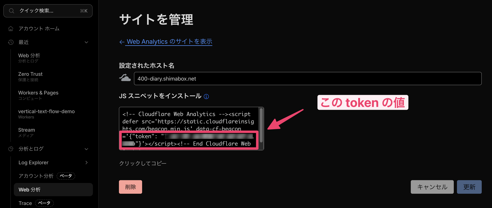

- `APP_NAME` と `APP_DESCRIPTION` は OGP 画像（SNS で共有したときのカード画像）にも使われる。`APP_NAME` はトップと日記ごとの画像、`APP_DESCRIPTION` はトップの画像に出る。OGP 画像は一度作ると R2 に保存されて使い回されるので、デプロイ後に値を変えたときは、保存された画像を消して作り直させる（[本番 R2 の OGP キャッシュ削除](../architecture/ogp-image.md#本番-r2-の-ogp-キャッシュ削除)）。

## 免責事項

この手順は参考情報として提供しています。Cloudflare の仕様変更により画面や手順が異なる場合があります。デプロイや設定に伴う費用・トラブルについては自己責任でお願いします。

## 前提条件

- [Cloudflare アカウント](https://dash.cloudflare.com/sign-up)を作成済みであること
- Node.js (v22 以上) がインストールされていること
- pnpm がインストールされていること
- リポジトリを fork し、`pnpm install` で依存パッケージをインストール済みであること

## D1データベースとR2バケットを作成

### D1データベースの作成

```
pnpm wrangler d1 create 400-diary-db
```

出力例:

```
✅ Successfully created DB '400-diary-db' in region APAC
Created your new D1 database.

[[d1_databases]]
binding = "_400_diary_db"
database_name = "400-diary-db"
database_id = "xxxxxxxx-xxxx-xxxx-xxxx-xxxxxxxxxxxx"
```

wrangler.toml の `database_id` を出力された値に更新する。

```
[[d1_databases]]
〜
database_id = "xxxxxxxx-xxxx-xxxx-xxxx-xxxxxxxxxxxx"
```

### R2バケットの作成

```
pnpm wrangler r2 bucket create 400-diary-images
```

出力例:

```
✅ Created bucket '400-diary-images' with default storage class of Standard.
```

### リモートDBにマイグレーションを適用

```
pnpm run db:migrate:remote
```

`wrangler d1 migrations apply` が未適用のマイグレーション（`db/migrations/`）だけを順に適用する。適用済みかどうかは D1 内の `d1_migrations` テーブルで管理されるため、何度実行しても安全。確認が求められるので `yes` を入力する。

なお `pnpm run deploy` はビルド後にこのコマンドを自動で実行するため、通常のデプロイで個別に実行する必要はない（スキーマ変更を伴うデプロイでマイグレーションの適用漏れが起きないようにするため）。

### OGP画像用フォントをR2にアップロード

OGP画像の生成に使用する Klee One フォントを R2 バケットにアップロードする。

```
bash scripts/upload-fonts.sh
```

> [!NOTE]
> フォントは [fontworks-fonts/Klee](https://github.com/fontworks-fonts/Klee) (SIL Open Font License) から取得されます。このステップは初回のみ必要で、以降のデプロイでは不要です。

## デプロイ

Cloudflare Access の設定の前に行う。URLを取得してからAccessの設定を行うため。

```
pnpm run deploy
```

Enterで進めていけばOK。

```
✨ Deployment complete! Take a peek over at https://xxxxxxxxxx
```

ここでのURLは、`https://400-diary.pages.dev/` として進めます。

> [!WARNING]
> `400-diary` の部分は `wrangler.toml` の `name` の値に対応しており、Cloudflare Pages 全体でユニークである必要があります。既に使われている名前の場合はデプロイ時にエラーになるので、別の名前に変更してください。実際のURLをメモしておいてください。

## Cloudflare Access の設定

Cloudflareダッシュボードで行う。

### 1. Cloudflare Zero Trustのセットアップ

Cloudflare Zero Trust にアクセスする。

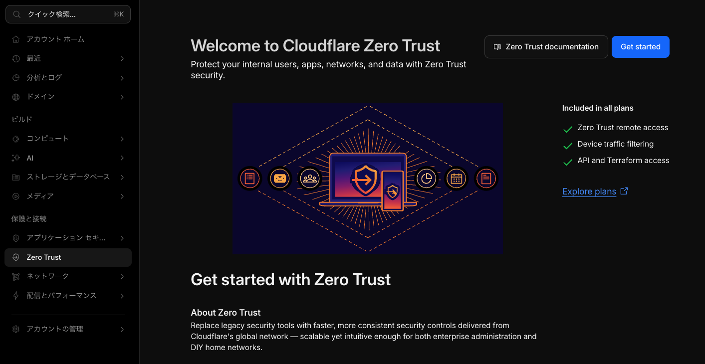

「Get started」をクリック。

### 2. チーム名の設定

初回はチーム名を求められるので、好きな名前を入力する。

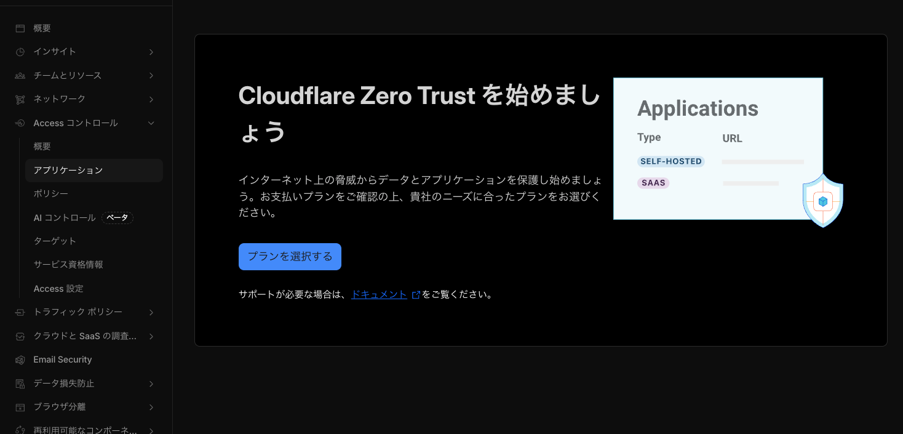

入力したチーム名がチームドメイン（`<チーム名>.cloudflareaccess.com`）になる。

### 3. プランの選択

プランは Free で OK。「Free を続ける」をクリック。

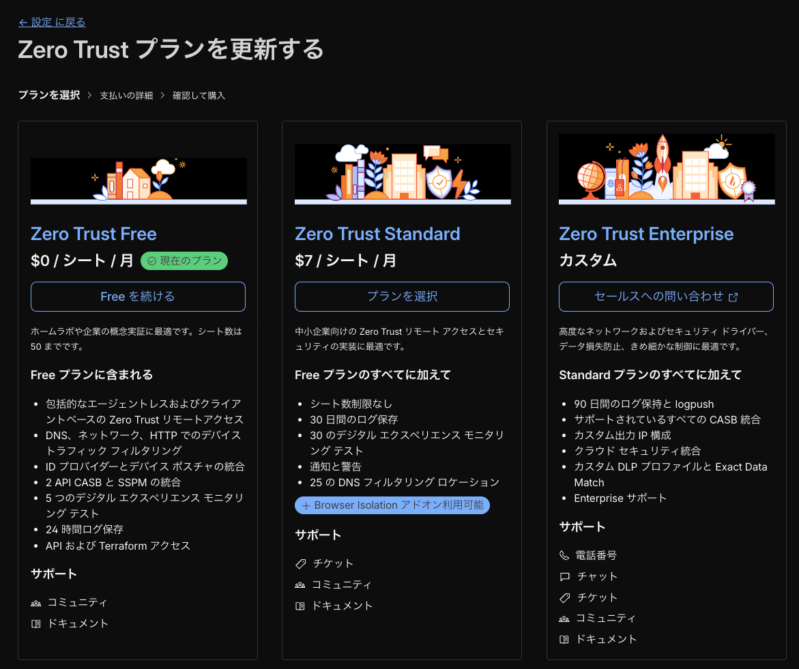

### wrangler.toml を更新

```
CF_ACCESS_TEAM_DOMAIN = "<チーム名>.cloudflareaccess.com"
```

### 4. Access アプリケーションの作成

Zero Trust ダッシュボードで Access > アプリケーション に移動し、「アプリケーションを追加する」をクリック。

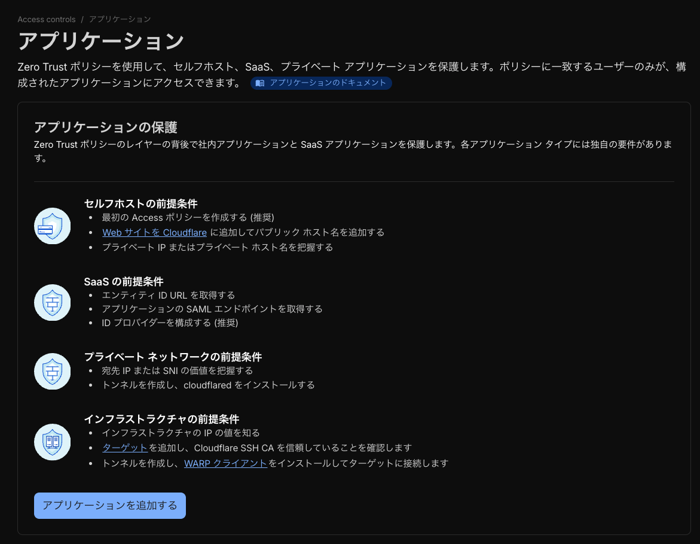

### 5. セルフホストを選択

「セルフホスト」を選択する。

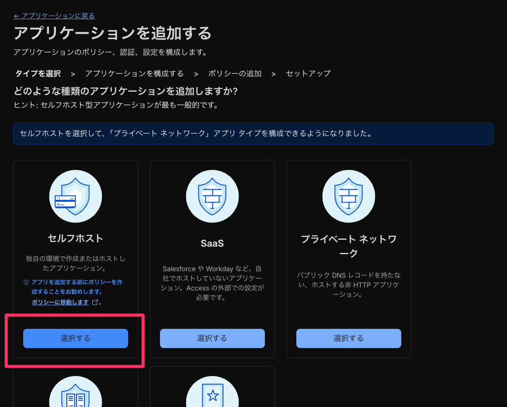

### 6. アプリケーションの基本情報とポリシー作成

「+ 新しいポリシーを作成する」をクリック。

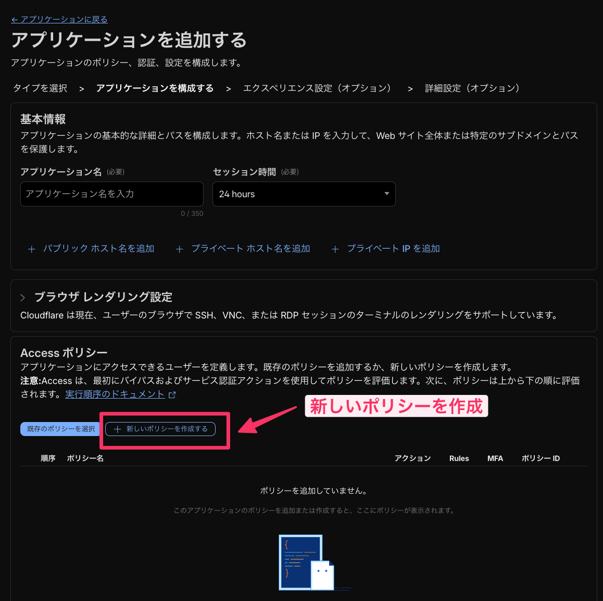

### 7. ポリシーの設定

以下を入力する:

1. ポリシー名: allow-owner（任意の名前でOK）
2. アクション: Allow（そのまま）
3. ルールのセレクター: ドロップダウンから Emails を選択
4. 値: 自分のメールアドレスを入力

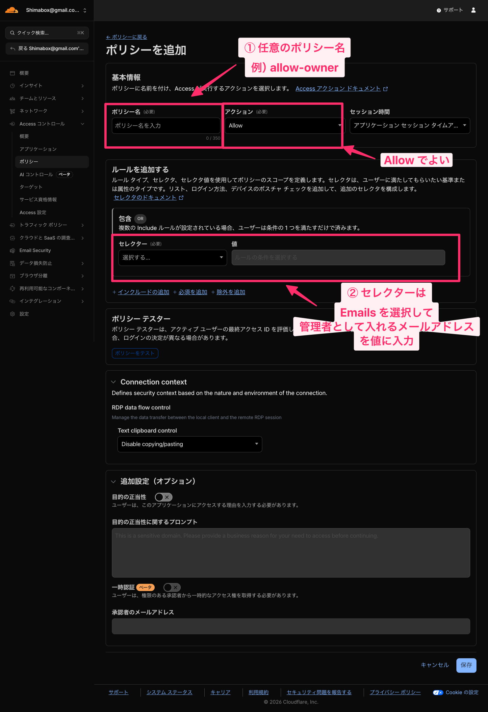

### 8. ポリシーの確認

作成したポリシーが一覧に表示される。

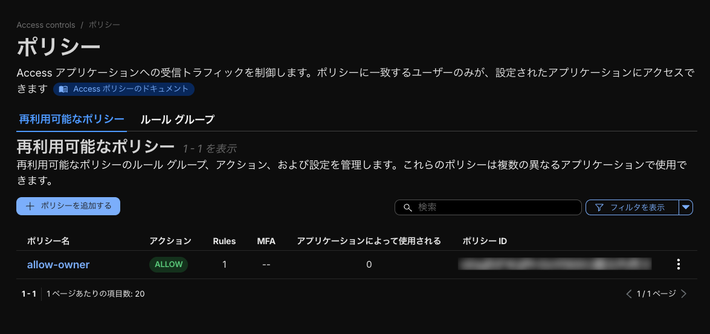

### 9. アプリケーション情報の入力

以下を設定する:

1. アプリケーション名: 400-diary（任意）
2. 「+ パブリック ホスト名を追加」をクリック
3. ドメイン: 自身のURLを選択
4. パス: `auth/400_diary` を入力（このパスのみに認証をかける。トップページや公開日記ページは認証不要のまま）
5. Access ポリシーで作成したポリシー（allow-owner）を選択

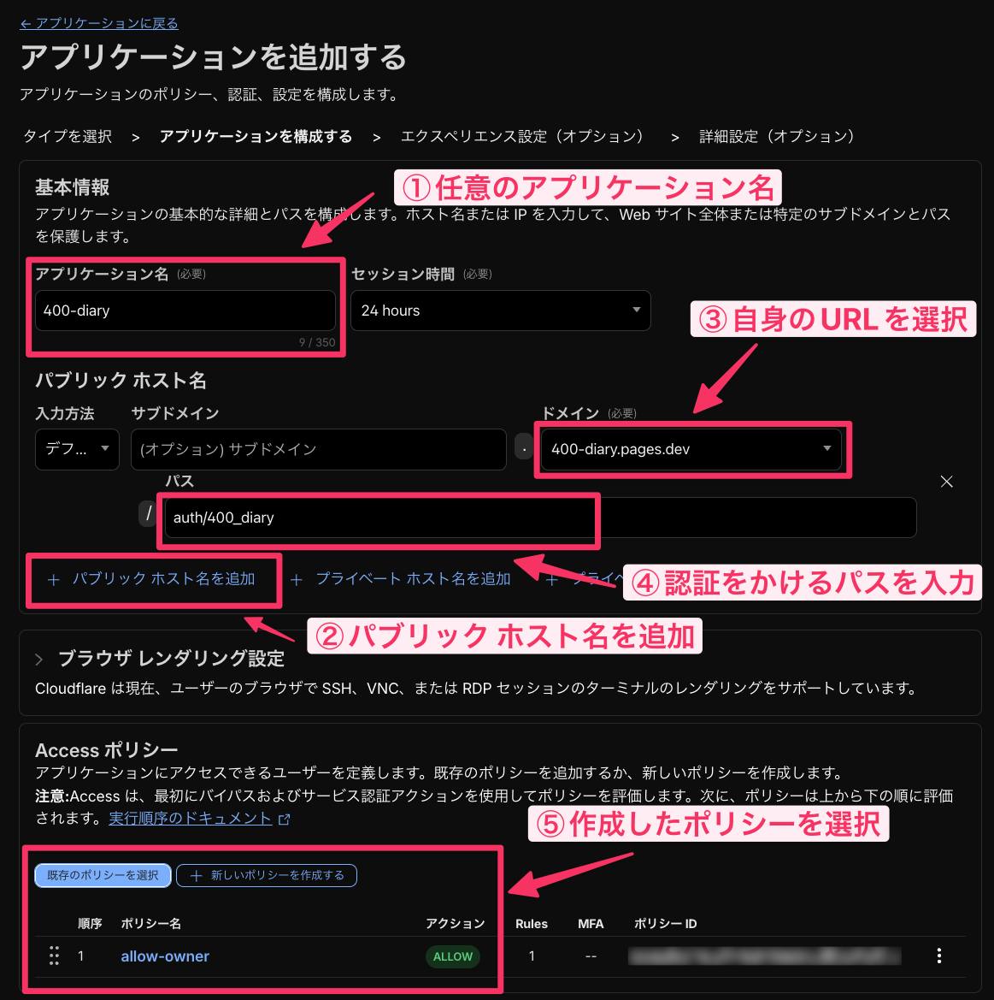

### 10. ログイン方法の設定

デフォルト（One-time PIN）のままでOK。「次へ」をクリック。

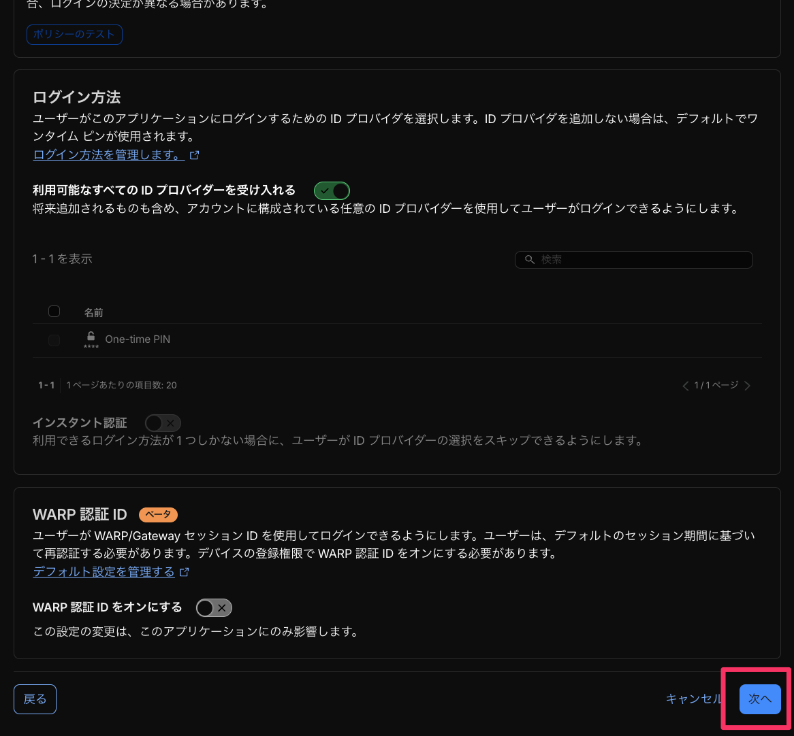

### 11. エクスペリエンス設定

デフォルトのままでOK。次のステップへ進む。

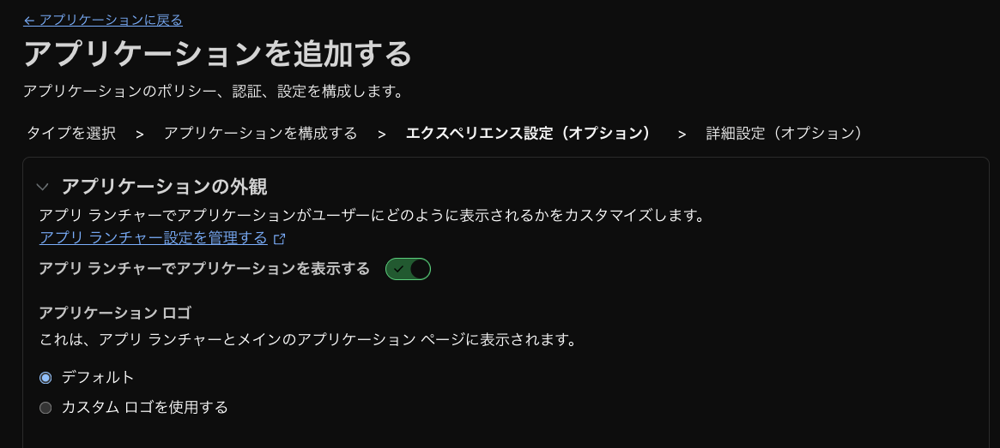

### 12. 詳細設定

デフォルトのままでOK。「保存」をクリック。

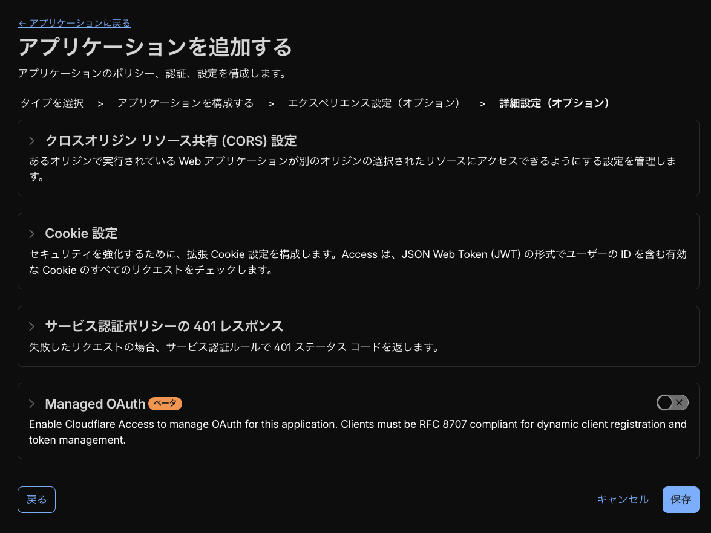

### 13. アプリケーションの作成完了

アプリケーション一覧にアプリケーションが表示される。

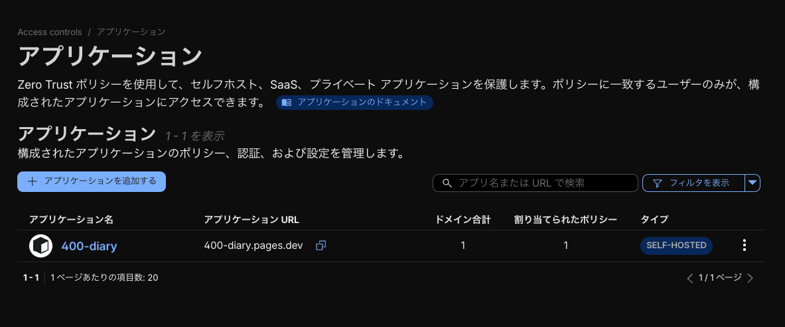

### 14. AUD の確認

アプリケーション一覧から作成したアプリケーションの右端の三点メニューから「編集」を開き、Application Audience (AUD) Tag を確認する。

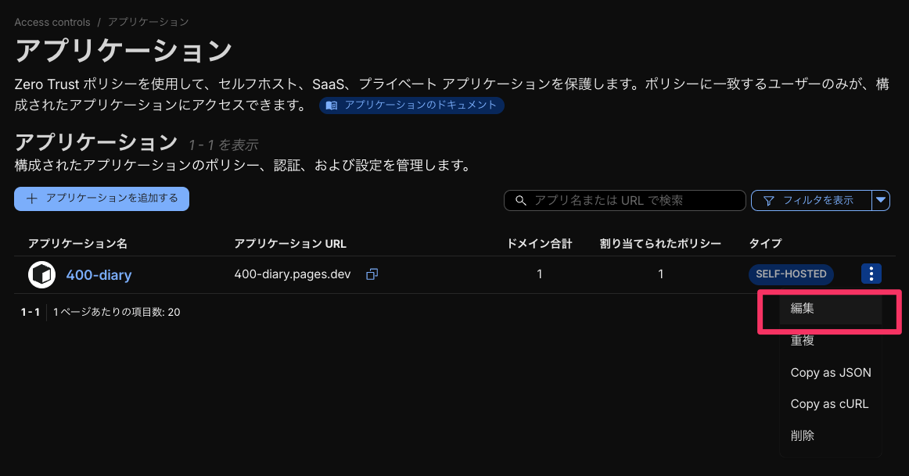

### wrangler.toml を更新

確認した AUD を設定する。

```
CF_ACCESS_AUD = "<確認した AUD の値>"
```

## 日記の読み上げ（任意）

日記を書き手本人の声で読み上げる機能を使う場合だけ行う。設定しなければ、編集画面に「音声を作る」が出ないだけで、他の機能はそのまま使える。

必要なもの:

- 有料枠（課金を有効にしたプロジェクト）の Gemini API キー
- Google AI Studio の Voice Replication で登録した、自分の声の ID（登録から 1 年で失効する）

この 2 つを Cloudflare Pages のシークレット `GEMINI_API_KEY` と `GEMINI_VOICE_ID` に登録する。シークレットはプロジェクトができてから登録できるので、最初のデプロイの後に行う。キーチェーンは手元の Mac だけのものなので、本番のサーバーが読めるよう同じ値を Cloudflare 側にも登録する必要があり、登録コマンドはそのシークレットが無ければ作り、あれば上書きする（詳細は [日記の読み上げ](../architecture/speech-output.md#キーの扱い) を参照）。

- macOS: キーチェーンに保存し、固定ラッパーで登録する。ラッパーは登録先のプロジェクト名を `wrangler.toml` の `name` から読む。

  ```
  security add-generic-password -a "$USER" -s 400-diary-gemini-api-key -w
  security add-generic-password -a "$USER" -s 400-diary-gemini-voice-id -w
  bash scripts/keychain/put-pages-secret-gemini-api-key.sh
  bash scripts/keychain/put-pages-secret-gemini-voice-id.sh
  ```

- それ以外: 次のコマンドを実行し、表示される入力欄に値を貼り付ける（値はコマンドに書かない）。`<プロジェクト名>` は `wrangler.toml` の `name` の値。Cloudflare のダッシュボード（Workers & Pages → 対象のプロジェクト → 設定 → 変数とシークレット）から「暗号化」の変数として登録してもよい。

  ```
  pnpm exec wrangler pages secret put GEMINI_API_KEY --project-name <プロジェクト名>
  pnpm exec wrangler pages secret put GEMINI_VOICE_ID --project-name <プロジェクト名>
  ```

シークレットは登録後のデプロイから有効になるので、次の再デプロイで反映される。ローカルでの試し方や声 ID が失効したときの手順は [日記の読み上げ](../architecture/speech-output.md#キーの扱い) を参照。

## 再デプロイと動作確認

wrangler.toml の更新を反映するために再デプロイする。

```
pnpm run deploy
```

デプロイ完了後、トップページにアクセスして動作確認する。

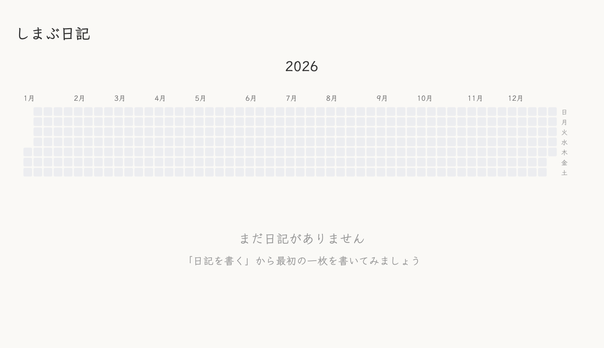

> [!NOTE]
> 左上のアプリ名は `wrangler.toml` の `APP_NAME`、説明文は `APP_DESCRIPTION`、下のリンクは `X_URL` と `GITHUB_URL` で変更できます（[wrangler.toml で書き換える値](#wranglertoml-で書き換える値)）。

以下を確認する:

1. トップページに認証なしでアクセスできること
2. 「日記を書く」ボタンが表示されていないこと（未認証状態）
3. `https://<自身のURL>/auth/400_diary` にアクセスすると Cloudflare Access のログイン画面が表示されること

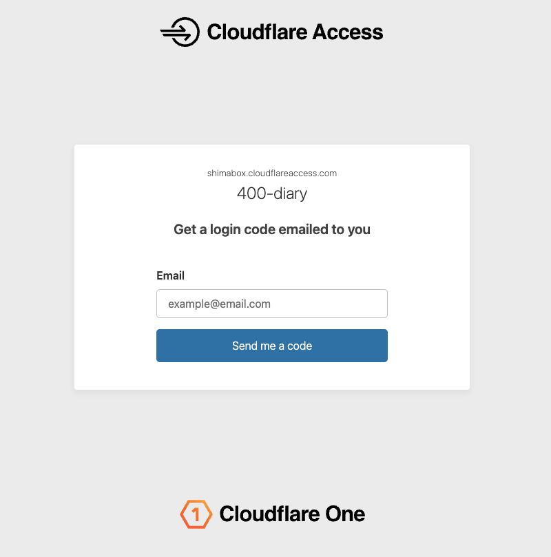

4. メールアドレスを入力し、ワンタイムコードで認証後、トップページにリダイレクトされること
5. 認証後「日記を書く」ボタンが表示され、日記の作成・編集・公開ができること

### 認証の解除

以下のURLにアクセスするとログアウトできる。

```
https://<チームドメイン>/cdn-cgi/access/logout
```

または、ブラウザの開発者ツールから `CF_Authorization` Cookie を削除しても同じ効果がある。
